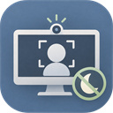

<h1> 在吗 AreYouThere</h1>

[](https://github.com/nathanatgit/AreYouThere/releases)

微软官方的“存在感知”(Presence Sensing) 只在部分新款设备上提供（需要专用的存在传感器）。**『在吗』**是它的轻量替代方案：用普通摄像头按间隔判断你是否在电脑前，在的时候阻止 Windows 自动息屏，离开后锁定电脑。

A lightweight workaround for Microsoft's official Presence Sensing feature, which is only available on some modern devices: AreYouThere uses an ordinary webcam to check whether you're at the PC, keeps the display on while you are, and locks the PC after you leave.

## 为什么做这个

Windows 只能靠“多久没碰键盘鼠标”来猜你在不在，这带来两个相反的问题：

- **人在，屏幕却暗了、锁了。** 读长文档、看代码、审图纸、听线上会议时，你一直坐在电脑前，只是没动键鼠。
- **人走了，屏幕还亮着。** 为了不被打断，很多人把息屏/锁屏时间调得很长，起身离开时屏幕内容就一直暴露在旁人眼前；忘了按 Win+L 也是一样。

『在吗』用摄像头判断你是否真的在电脑前：在的时候屏幕常亮，离开后在设定的延迟后锁定电脑。**它的首要目的是保护你的屏幕隐私**：人不在时，不让别人看到你的屏幕内容。

同时，『在吗』本身也不应成为隐私隐患：完全离线，没有任何联网功能，画面只在本机内存中分析后立即丢弃，不保存、不上传。

## 适用场景

- **办公室、开放工位**：起身倒水、去开会、临时被叫走时自动锁屏，同事和路过的人看不到你的邮件、聊天和工作文件；坐着阅读时屏幕不会变暗
- **家里**：离开后自动锁定，避免家人、室友或孩子看到聊天记录、工作内容，或误操作电脑
- **长时间“只看不动”的工作**：阅读、写作构思、看代码、审图、看监控面板、听网课或线上会议，不必隔几分钟晃一下鼠标
- **公共场所**（咖啡馆、图书馆、共享办公区等）：把人脸面积阈值调大，只认离摄像头很近的你，旁边和身后的人会被忽略，离开后照常锁定。请遵守场所规定，并注意摄像头指示灯可能让周围的人误以为你在拍摄
- **没有存在传感器的电脑**：台式机外接摄像头，或不支持“存在感知”的旧笔记本

## 不适合的情况

- **需要可靠安全保障的场景**：『在吗』只检测人脸，**不识别是不是你本人**。只要有一张足够近的人脸（包括别人坐到你的位置，甚至一张照片），它就会认为你在电脑前。它是减少屏幕暴露的便利工具，不是安全产品，不能代替离开时手动锁屏的习惯、Windows Hello 等身份验证或组织的安全策略
- **从你离开到锁定有一段延迟**：最长约为“检测间隔 + 锁定延迟”（默认 60 秒 + 30 秒）。缩短检测间隔可以更快锁定，但摄像头工作更频繁

## 功能

- **完全离线**：程序没有任何联网功能，不上传、不收集、不保存任何画面或检测数据，画面只在本机内存中分析后立即丢弃；偏好设置仅保存在本机
- 默认每 30 秒检测一次（可按时、分、秒自定义，最短 5 秒），使用 Windows 自带的人脸检测
- 坐姿检测（默认开启，每 10 分钟检测一次）：人脸低于预览中设定的坐姿线时提醒你坐直、别驼背；人脸太大（离屏幕太近）时提醒你坐远一些。坐姿可跟随在场检测一起检测，也可自定义单独的检测间隔（开着智能检测打字时也会照常检测）
- 通知可设置：默认在全屏应用（如游戏）前台时不弹出提醒，也可选择永不通知或始终通知
- 画面方向可旋转：个别摄像头送来的画面是横的或倒的，转正后检测才准确；每个摄像头单独记住
- 智能检测（默认开启）：使用键盘鼠标时视为你在电脑前，不打开摄像头；停止操作达到设定时间后才开始检测，更省电、指示灯亮得更少
- 离开后默认由『在吗』接管，在设定延迟后锁定电脑，避免屏幕暴露给他人；也可改为跟随系统电源策略（并显示当前息屏/睡眠/锁屏时间）
- 省电：不显示预览时，只在每次检测时打开摄像头约 1–2 秒，其余时间关闭；界面底部按当前设置提示耗电程度
- 可选择使用哪个摄像头；插拔摄像头自动刷新；没有摄像头或没有权限时给出提示
- 实时摄像头预览和人脸框，框上显示人脸占画面的面积百分比，便于调整摄像头位置
- 人脸面积阈值（滑块可调）：只有足够近的人脸才算你在电脑前，远处的人或墙上的照片会被忽略；阈值太小时，在公共场所可能把附近的人当成你，离开后不会锁定
- 检测到多张近处人脸时弹出提醒：只要有一张还在，就会认为你在电脑前
- 托盘图标：单击打开窗口，右键启用/关闭或退出；关闭窗口后继续在托盘运行
- 电脑锁定时自动暂停检测，解锁后恢复；设置自动保存
- 可选开机自启动（默认关闭）：启用时需明确确认摄像头与公共场所隐私提醒；登录 Windows 后弹出提醒，点击“确定”后才按当前配置开启检测并驻留托盘。手动打开程序仍默认关闭检测
- 隐藏操作：在开机提醒的“确定”按钮上持续按住 5 秒，可选择永久关闭以后的开机提醒；只有二次确认后才保存，以后登录会直接自动检测。设置中可恢复提醒，重新启用开机自启动也会恢复提醒
- 检测到 PowerToys Awake 处于保持唤醒模式时提示可能冲突

## 下载

到 [Releases](https://github.com/nathanatgit/AreYouThere/releases) 下载，x64 / x86 / ARM64 都有：

- **MSI**：安装版，推荐
- **便携版 exe**：单个文件，下载即用
- **zip**：文件夹版，解压后运行 `AreYouThere.exe`

需要 Windows 10 1809 或更高版本。

便携版开启自启动后请保留在固定路径；移动或改名后需重新启用此选项。自启动仅适用于当前 Windows 用户，Windows 的启动应用设置或组织策略可能阻止运行。取消自启动不会停止当前正在进行的检测，可单独关闭检测或从托盘退出。

## 从源码构建

需要 .NET 8 SDK：

```powershell
dotnet build AreYouThere\AreYouThere.csproj -p:Platform=x64
```

## 隐私

『在吗』完全离线运行，不收集任何数据，详见 [隐私政策](PRIVACY.md)。

## 许可证

[MIT](LICENSE)
