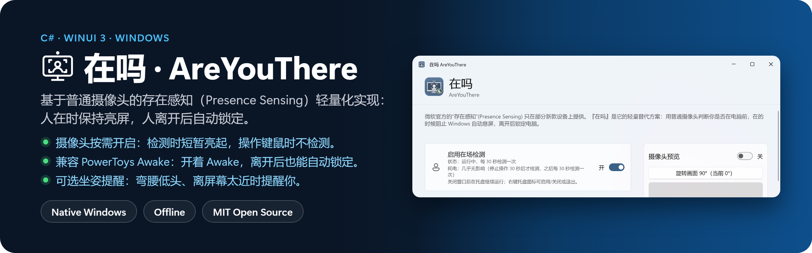

[](https://github.com/nathanatgit/AreYouThere/releases)

微软官方的“存在感知”(Presence Sensing) 只在部分新款设备上提供（需要专用的存在传感器）。『**在吗**』是它的轻量替代方案：用普通摄像头按间隔判断你是否在电脑前，在的时候阻止 Windows 自动息屏，离开后锁定电脑。

A lightweight workaround for Microsoft's official Presence Sensing feature, which is only available on some modern devices: AreYouThere uses an ordinary webcam to check whether you're at the PC, keeps the display on while you are, and locks the PC after you leave.

## 为什么做这个

Windows 只能靠“多久没碰键盘鼠标”来猜你在不在，这带来两个问题：

- **人在，屏幕却暗了、锁了。** 读长文档、看代码、审图纸、听线上会议时，你一直坐在电脑前，只是没动键鼠。
- **人走了，屏幕还亮着。** 为了不被打断，很多人把息屏/锁屏时间调得很长，起身离开时屏幕内容就一直暴露在旁人眼前。
- **Powertoys Awake 忘记关闭。** 有时候你忘了按Win+L。

『在吗』用摄像头判断你是否真的在电脑前：在的时候屏幕常亮，离开后在设定的延迟后锁定电脑。**它的首要目的是保护你的屏幕隐私**：人不在时，不让别人看到你的屏幕内容。

同时，『在吗』本身也不应成为隐私隐患：完全离线，没有任何联网功能，画面只在本机内存中分析后立即丢弃，不保存、不上传。

## 适用场景

- **办公室、开放工位**：起身倒水、去开会、临时被叫走时自动锁屏，同事和路过的人看不到你的邮件、聊天和工作文件；坐着阅读时屏幕不会变暗
- **家里**：离开后自动锁定，避免家人、室友或孩子看到聊天记录、工作内容，或误操作电脑
- **长时间“只看不动”的工作**：阅读、写作构思、看代码、审图、看监控面板、听网课或线上会议，不必隔几分钟晃一下鼠标
- **公共场所**（咖啡馆、图书馆、共享办公区等）：把人脸区域识别阈值调大，只认离摄像头很近的你，旁边和身后的人会被忽略，离开后照常锁定。请遵守场所规定，并注意，摄像头指示灯可能让周围的人误以为你在拍摄
- **没有存在传感器的电脑**：台式机外接摄像头，或不支持“存在感知”的旧笔记本

## 不适合的情况

- **需要可靠安全保障的场景**：『在吗』只检测人脸，**不识别是不是你本人**。只要有一张足够近的人脸（包括别人坐到你的位置，甚至一张照片），它就会认为你在电脑前。它是减少屏幕暴露的便利工具，不是安全产品，不能代替离开时手动锁屏的习惯、Windows Hello 等身份验证或组织的安全策略
- **从你离开到锁定有一段延迟**：最长约为“检测间隔 + 锁定延迟”（默认 30 秒 + 10 秒；开启智能检测时从最后一次操作键盘鼠标算起）。缩短检测间隔可以更快锁定，但摄像头工作更频繁

## 功能

**完全离线**：程序没有任何联网功能，不上传、不收集、不保存任何画面或检测数据，画面只在本机内存中分析后立即丢弃；偏好设置仅保存在本机。

### 在场检测

- 使用 Windows 自带的人脸检测，默认每 30 秒检测一次，可按时、分、秒自定义（最短 5 秒）
- **智能检测**（默认开启）：使用键盘鼠标时视为你在电脑前，不做在场检测；停止操作达到设定时间后才开始检测，更省电、摄像头指示灯亮得更少
- **人脸区域识别阈值**：人脸区域占画面的百分比达到阈值才算你在电脑前，远处的人或墙上的照片会被忽略；在公共场所请适当调大，避免把路人当成你
- 检测到多张近处人脸时提醒：只要其中一张还在，就会认为你在电脑前
- 电脑锁定时自动暂停检测，解锁后恢复
- 节电模式（Windows 11 24H2 起为“节能模式”）开启时默认暂停检测，交给系统电源设置，关闭后自动恢复；也可以设置为节电模式下继续检测。开启、关闭时都会通知

### 坐姿检测

- 默认关闭，可在“检测”中开启
- 人脸低于预览中设定的坐姿线时提醒“记得抬头挺腰”，人脸太大（离屏幕太近）时提醒“注意用眼距离”；提醒后 5 分钟内再次发现问题，会提醒你休息一下
- 坐姿线高度阈值和距离阈值在预览中用滑块调整，人脸区域框由橙变绿即为合适
- 可跟随在场检测一起检测，或自定义单独的检测间隔（默认每 10 分钟）；自定义间隔时，开着智能检测打字也会照常检测

### 锁定策略

- 离开后默认由『在吗』接管，在设定延迟后锁定电脑，避免屏幕暴露给他人；也可改为跟随系统电源策略（并显示当前息屏/睡眠/锁屏时间）
- 锁定时机按时长设置（默认 10 秒，设为 0 秒立即锁定）；倒计时期间回到摄像头前即可取消
- 倒计时期间压暗屏幕（默认开启），提醒你快要锁定了。可选两种方式：
  - **黑色遮罩**：所有显示器都有效，压暗强度调到 100% 时整屏全黑，临时挡住屏幕内容
  - **降低显示器亮度**：笔记本内置屏和支持 DDC/CI 的外接显示器直接调亮度；不支持的显示器自动改用遮罩。倒计时结束、回来或锁定后恢复原亮度，程序意外退出后下次启动也会恢复
- 压暗强度用滑块调整，按住拖动即可预览，松开恢复

### 摄像头与预览

- 可选择使用哪个摄像头；插拔摄像头自动刷新；没有摄像头、没有权限或摄像头被其他程序独占时给出提示
- 以共享模式读取摄像头，不会占住摄像头，视频会议、录像软件仍可正常使用
- 画面方向可旋转：个别摄像头送来的画面是横的或倒的，转正后检测才准确；每个摄像头单独记忆
- 实时预览和人脸框，框上显示人脸占画面的面积百分比，便于调整摄像头位置
- 省电：只在每次检测时打开摄像头约 1–2 秒，其余时间关闭；状态卡片按检测频率提示耗电程度

### 界面与设置

- Windows 11 风格的设置卡片和沉浸式标题栏（Windows 10 场景自动回退）
- 主题可选跟随系统、浅色或深色；界面支持简体中文和英文，默认跟随系统语言
- 通知可设置：默认在全屏应用（如游戏）前台时不弹出提醒，也可选择永不通知或始终通知
- 顶部的离线说明和隐私提醒可以关闭，之后可在“其他设置”中重新显示

### 托盘与开机自启动

- 托盘图标：单击打开窗口，右键启用/关闭或退出；关闭窗口后继续在托盘运行
- 暂停检测：在托盘右键菜单或窗口中暂停 15 分钟到 2 小时，到时自动恢复，也可随时手动恢复
- 可选开机自启动（默认关闭）：启用时需明确确认摄像头与公共场所隐私提醒；登录 Windows 后弹出提醒，点击“确定”后才按当前配置开启检测并驻留托盘。手动打开程序仍默认关闭检测
- 隐藏操作：在开机提醒的“确定”按钮上持续按住 5 秒，可选择永久关闭以后的开机提醒；只有二次确认后才保存，以后登录会直接自动检测。设置中可恢复提醒，重新启用开机自启动也会恢复提醒

## 下载

到 [Releases](https://github.com/nathanatgit/AreYouThere/releases) 下载，x64 / x86 / ARM64 都有：

- **MSI**：安装版，推荐
- **便携版 exe**：单个文件，下载即用
- **zip**：文件夹版，解压后运行 `AreYouThere.exe`

需要 Windows 10 1809 或更高版本。

便携版开启自启动后请保留在固定路径；移动或改名后需重新启用此选项。自启动仅适用于当前 Windows 用户，Windows 的启动应用设置或组织策略可能阻止运行。取消自启动不会停止当前正在进行的检测，可单独关闭检测或从托盘退出。

## 从源码构建

需要 .NET 8 SDK：

```powershell
dotnet build AreYouThere\AreYouThere.csproj -p:Platform=x64
```

## 隐私

『在吗』完全离线运行，不收集任何数据，详见 [隐私政策](PRIVACY.md)。

## 许可证

[MIT](LICENSE)
